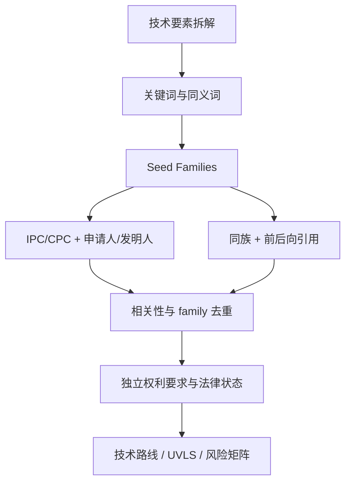

# 研究方法

## 1. 分析单位与时间轴

- 以 **Patent Family** 而不是公开号为统计和叙事单元；同一发明的 WO/EP/US/JP/CN/KR 公开不重复计数。
- 技术演进时间采用 **earliest priority date**；同时保留 filing、publication、grant，避免把公开年份误当发明时间。
- continuation/divisional 若独立权利要求实质变化，则保留在同一 extended family 下的独立 claim 分支，而不把它简单折叠掉。
- applicant、original assignee、current assignee 分开记录；当前权利人和法律状态只在可验证时填写。

## 2. 检索流程

1. 将 LS 拆为光源、投影、晶圆/膜堆、收集、探测、解调、标定、stage 协同、topography reconstruction。
2. 用公开说明书和两份学位论文建立术语表，不只检索 “Level Sensor”。
3. 先找能明确映射到设备结构或物理问题的 Seed Families。
4. 对 seed 做 IPC/CPC、申请人、发明人、family、backward/forward citation 的 pearl-growing。
5. 用权利要求相关性和设备边界收敛；不因标题含 focus/level 就纳入，也不为增加数量无限扩张。
6. Landscape 分析使用摘要、说明书和元数据；Preliminary FTO 只对有效/在审候选的 **Independent Claims** 做要素映射。

## 3. 借鉴的开源方法

本项目在正式检索前阅读了以下公开项目，并仅吸收方法，不复制其成果或修改其仓库：

- [LeonardHope/Claude-Skill-for-Patent-Landscape-Analysis](https://github.com/LeonardHope/Claude-Skill-for-Patent-Landscape-Analysis)：family 去重、earliest-priority 时间线、申请人归一化、CPC 聚类和所有统计的 provenance；同时坚持 landscape 不等于 claim/FTO。
- [djfksjd/patent-search-skill](https://github.com/djfksjd/patent-search-skill)：技术要素拆解、检索日志、family/citation expansion、claim chart、法律状态 gate 与 preliminary FTO 的边界。
- [Open2Loop/claude-patent-skills](https://github.com/Open2Loop/claude-patent-skills)：examiner-style element decomposition、关键词到分类号的迭代、字段/邻近/申请人/发明人组合和独立权利要求分析。

## 4. 相关性与证据等级

### 技术相关性

- **A — 核心 LS**：独立权利要求直接覆盖晶圆/基板表面位置、focus/level/topography 的测量结构或信号处理。
- **B — 关键子系统**：覆盖 LS 的光源、投影光栅、探测阵列、校准、过程依赖补偿或 stage 协同。
- **C — 邻接技术**：overlay/alignment、膜厚测量、defocus correction 等可解释 LS 演进但不直接覆盖核心 LS。
- **D — 背景**：仅作为历史或物理机制证据。

### 结论证据

- **E1**：公开专利全文/独立权利要求，或官方登记簿记录。
- **E2**：Google Patents / Espacenet / PATENTSCOPE 元数据或 family 映射，尚未由各国官方登记簿复核。
- **E3**：同行评议论文、学位论文或厂商文献对技术路线的二次说明。
- **E4**：由检索结果推导的假设；只能标作“推测/待验证”。

## 5. 法律状态和风险规则

Google Patents 的 “Active/Expired/Pending” 仅作 E2 初筛。进入 HIGH/MEDIUM 的 family，后续必须核验目标国家官方登记簿、年费、期限调整、终止声明、异议/无效、权利人变更和分案/继续申请。

风险标签：

- **HIGH**：目标地域存在有效/在审独立权利要求，覆盖典型 LS 必需模块或难以绕开的组合；
- **MEDIUM**：有较强要素重合，但可通过波段、光路、信号链、控制关系或适用场景设计绕开；
- **LOW**：权利要求较窄、地域有限、期限接近或与目标架构仅部分重合；
- **BACKGROUND**：已届满/失效，或只用于理解 prior art，不代表无效专利可以任意复制其后续改进。

风险是 family × jurisdiction × claim branch × product design 的函数。数据库中的单一风险字段仅用于排队，不是侵权判断。

## 6. 两份随附技术资料的使用

- 《纳米光刻中调焦调平测量系统的研究》（中国科学院大学，2016）：用于三角测量、莫尔差分、宽谱大入射角降低薄膜依赖，以及 Nikon/Canon/ASML 历史路线的 seed 提取。
- 《反射式光学调焦调平测量系统技术研究》（中国科学院大学，2021）：用于 ASD/GPD 两类工艺依赖、600–1000 nm 反射式 Offner 光路、短波/大入射角/偏振优化及中国专利线索。

论文中的专利号、性能和公司路线属于 E3；关键结论必须回到对应专利全文升级到 E1/E2。

## 7. 可复现性

每次主要检索保存日期、数据库、查询式、过滤条件、命中数（若界面可稳定获得）和被纳入的 seed。数据表保留代表公开号、family ID/成员、earliest priority、技术标签、证据 URL 和核验状态。任何人工归一化或推断均在 notes 中说明。
