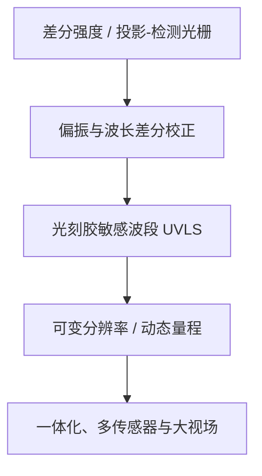
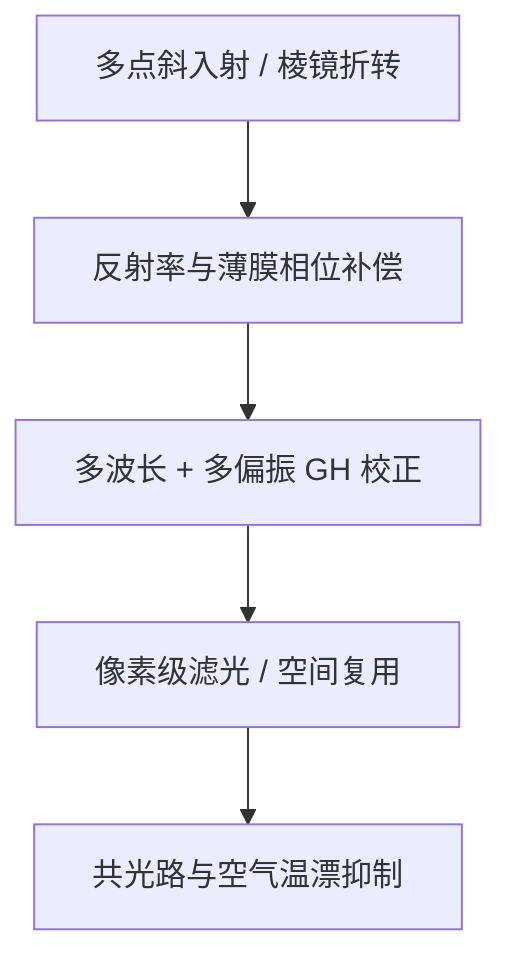

# 厂商技术路线重建

本章按“早期架构 → 暴露的问题 → 后续解决 → 当前路线”组织，不按专利逐篇复述。时间均优先采用 earliest priority。

## 1. ASML：从差分光栅到表面选择性、紧凑多通道和大视场

### 早期架构与问题

ASML/Philips 的基础路线是斜入射三角测量：把周期图形投到晶圆，反射像随高度横向移动，再由检测光栅或差分通道把位移变成强度。该架构灵敏、适合多点并行，但有两个根本问题：一是透明光刻胶/多层膜把“表面位置”变成多个界面反射的相位加权结果；二是投影光栅、检测光栅和光路零位的微小漂移会直接变成假高度。历史 seed 为 [US4866262A](https://patents.google.com/patent/US4866262A/en) 和 [US5191200A](https://patents.google.com/patent/US5191200A/en)。

### 从校正 process dependency 到改变测量物理

[US7265364B2](https://patents.google.com/patent/US7265364B2/en) 用不同偏振或波长属性的两次测量之差识别/校正 process dependency。这仍属于“可见/近红外测到了混合界面，再从数据里纠偏”。2009 年优先权的 [US8842293B2](https://patents.google.com/patent/US8842293B2/en) 改变了问题：独立权利要求要求在光刻胶敏感的 actinic 波段用反射光测光刻胶表面，依赖权利要求覆盖小于 400 nm、剂量控制和离轴光路。其意图是让光在胶内更快衰减，从源头压低下层反射，而不仅是拟合误差。

### 分辨率、量程和通量

精度提升后，单一 footprint 不能同时满足局部边缘/微形貌和低噪声高速扫描。[US20130128247A1](https://patents.google.com/patent/US20130128247A1/en) 通过选择不同探测子区改变有效空间分辨率；[WO2018082892A1](https://patents.google.com/patent/WO2018082892A1/en) 通过选择探测单元或移动光学件改变参考高度/量程，以避免高灵敏度光栅牺牲 capture range。

### 当前架构

2014–2019 年路线明显转向可制造性和通道密度：[WO2016102127A1](https://patents.google.com/patent/WO2016102127A1/en) 让探测阵列直接采样反射周期图形，减少独立检测光栅；[WO2017153069A1](https://patents.google.com/patent/WO2017153069A1/en) 用执行器调投影/检测元件闭环校准；[WO2019197111A1](https://patents.google.com/patent/WO2019197111A1/en) 把检测光栅和下游光学件做成单体并扩展到多束；[US11662669B2](https://patents.google.com/patent/US11662669B2/en) 处理不同 footprint 传感器的数据融合。

最新公开显示这条路线继续向“全宽、高通量、可封装”推进：2024 年优先权的 [WO2026046750A1](https://patents.google.com/patent/WO2026046750A1/en) 用光纤芯阵列把条纹不同相位部分送到临界体积外的探测器；[WO2026052495A1](https://patents.google.com/patent/WO2026052495A1/en) 用子视场、镜面中继和场镜形成 150–300 mm 共线/并行照明；[WO2026068338A1](https://patents.google.com/patent/WO2026068338A1/en) 用两个错位的凹/凸反射中继扩展视场。

**路线判断：** ASML 的核心不是单一 UV 光源，而是“物理上减少 process stack 影响 + 多通道差分/校正 + 紧凑稳定的反射/阵列光学 + 双工位高速 wafer map”。发明人和引用连续性很强，且最新 PCT 仍明确回引 2003/2004/2009 年 LS families。

## 2. Nikon：条纹投影、偏振/光谱解耦和环境误差工程

### 光学骨架

[US9069261B2](https://patents.google.com/patent/US9069261B2/en) 所在 continuation 链最能代表 Nikon 的骨架：斜入射多点投影、双侧远心/Scheimpflug 成像以及 pentaprism/rhombic-prism 式折转。目标不仅是把光塞进物镜周围的狭窄空间，还要抑制棱镜多次内反射导致的偏振分量位置差。Yasuhiro Hidaka 和 Tadashi Nagayama 在 continuation 中反复出现，属于明确的发明人连续性。

### 从强度补偿到相位机制

[US7982884B2](https://patents.google.com/patent/US7982884B2/en) 把局部反射率信息作为狭缝信号的补偿因子，解决“暗是因为离焦还是因为反射率低”。随后 [US20110071784A1](https://patents.google.com/patent/US20110071784A1/en) 及有效 continuation 把问题表述为 Goos–Hänchen/薄膜反射相位：同时获得多波长、多偏振的 Z/反射率信号，再通过加权或回归估计真实高度。这是 Nikon 对 process stack 的主路线，和 ASML 的 UV 表面选择性形成鲜明差别。

### 探测与环境

[US20130208104A1](https://patents.google.com/patent/US20130208104A1/en) 将颜色/偏振滤光直接集成到 CCD 像素，减少分离光路的空气温差、机械错位和像素浪费；[US9243901B2](https://patents.google.com/patent/US9243901B2/en) 则通过不同波长对应不同光栅周期/入射条件，使 wafer-height 相位灵敏度与空气光程变化的波长依赖相匹配，并尽量形成共光路。US9030668B2 和 US8993974B2 分别显示多条纹空间复用与 color-TDI 高速扫描支线，但尚需逐项完成独立权利要求复核。

**路线判断：** Nikon 更偏向“保留宽谱/多色条纹投影，通过偏振、光谱和参考/测量共光路估计并抵消物理误差”。核心布局高度集中在 2005–2013 的 family 群；本轮尚未发现同等密度、明确以 LS/AF 命名的 2015 年后新 family，因此“近年退出研发”不能下结论，只能列为检索待验证。

## 3. Canon：多点宽谱扫描、设备基准传递和量程自适应

### 早期路线

Canon 早期专利和随附论文显示其用多波长加权降低膜干涉，用多个针孔/狭缝采样晶圆面，并通过预扫描或双向扫描生成面形。[US6081614A](https://patents.google.com/patent/US6081614A/en) 是多点扫描的基础 seed；[US5118957A](https://patents.google.com/patent/US5118957A/en)、[US7668343B2](https://patents.google.com/patent/US7668343B2/en) 需要继续完成 primary metadata 与 claim mapping，但二次资料一致指向宽谱/多源、远心光路和线阵检测。

### 从光学头转到设备级误差闭环

[US20150042969A1](https://patents.google.com/patent/US20150042969A1/en) 代表明显转折：同一晶圆在 measurement station 由离轴 LS 测面形，在 exposure station 用另一表面/基准测量关系校正双工位之间的 stage/reference 差异。要解决的不是某一光栅的灵敏度，而是测量地图跨工位传递时的 bar mirror、基准形状和热漂移。

2021 年优先权 family（代表 [US20240061350A1](https://patents.google.com/patent/US20240061350A1/en)）进一步用不同量程/精度的表面位置数据拟合近似面，并根据阈值和既有曝光区域信息选择 correction。它与 ASML 的 footprint fusion 类似地反映出：现代 LS 已经从“一个光学传感头”扩展为“多源数据 + 模型 + 曝光控制”。

**路线判断：** Canon 的长期重点是多点快速表面测量及其在扫描/双工位曝光中的使用；近年的可见专利更偏向参考传递、量程和控制策略，而不是公开一种全新的 UV 光学头。

## 4. 中国与其他研发单位

### 上海微电子装备（SMEE）

从 2005 到 2018 至少形成连续链：可变孔径/差分莫尔 [CN1700101B](https://patents.google.com/patent/CN1700101B/zh) → 宽谱全反射/阶梯镜 [CN1971426A](https://patents.google.com/patent/CN1971426A/zh) → 粗精双支路 [CN101276160B](https://patents.google.com/patent/CN101276160B/zh) → 非对称共轭抑制多层图形 [CN104880913B](https://patents.google.com/patent/CN104880913B/zh) → 模拟归一化 [CN105093837B](https://patents.google.com/patent/CN105093837B/zh) 与扫描镜漂移监测 [CN106997152B](https://patents.google.com/patent/CN106997152B/zh) → 空间偏振差分线扫描 [CN108106561B](https://patents.google.com/patent/CN108106561B/zh) → 错位子探测光栅 [CN110095944B](https://patents.google.com/patent/CN110095944B/zh)。这不是零散科研申请，而是从光学头、信号归一化到运动件监控的系统化布局。

### 科研机构

- 中国科学院光电技术研究所的 [CN105242501B](https://patents.google.com/patent/CN105242501B/zh) 用空间四通道、正交相位莫尔和比值信号降低光源/反射率扰动；当前公开状态显示 CN/US 因费用失效，主要作为技术背景。
- 中国科学院微电子研究所的 [CN115185161A](https://patents.google.com/patent/CN115185161A/zh) 把检测光栅变为可编码传感器像素上的数字光栅，用合成莫尔和相位算法提升速度/灵活性；2025 年已授权，属于新的风险候选。
- 华中科技大学与 SMEE 共同申请 [CN101276160B](https://patents.google.com/patent/CN101276160B/zh)，说明高校在粗精测量和多点体系中参与产业化路线。

TSMC、Samsung 等发现的 topography/leveling 专利多数偏向晶圆形貌数据的曝光补偿或 stage 算法；在独立权利要求没有直接覆盖 LS 光学头前，本项目只列为邻接技术，不与设备厂的核心 LS family 混计。

## 5. 三家共性与差异

| 维度 | ASML | Nikon | Canon |
|---|---|---|---|
| 基础几何 | 斜入射、周期图形、差分/阵列 | 斜入射条纹、多点、棱镜折转 | 斜入射、多波长、多点扫描 |
| process stack | actinic UV/DUV 直接增强表面选择性；兼有波长/偏振校正 | 多波长 × 多偏振、GH/反射相位模型 | 宽谱/多色加权，随后更多交给设备模型 |
| 稳定性 | 主动光学校准、单体检测件、传感器融合 | 共光路、像素级滤光、空气 OPD 配平 | 测量站—曝光站基准传递 |
| throughput | 多通道、可变 footprint、150–300 mm 大视场 | 空间复用、TDI/CCD、多色同步 | 预扫描/双向扫描、双工位并行 |
| 最新可见信号 | 光纤远置探测、field splitting、双反射中继 | 本轮尚未确认 2015 后同密度 LS family | 不同量程/精度的自适应面形控制 |
| 核心壁垒 | UVLS 波段选择；紧凑多通道；大视场 | 光谱/偏振 GH 校正；像素滤光；OPD 配平 | 双工位参考关系；表面数据使用逻辑 |

三家共同面对的是同一个系统矛盾：短焦深要求更高精度，而真实晶圆不是理想镜面；想提高局部空间分辨率会损失光子和通量，想提高灵敏度会缩小量程，想增加通道又会放大标定与热漂移问题。差异主要在误差处理哲学：ASML 更愿意改变测量波段和光机架构，Nikon 更强调多维光谱/偏振解耦，Canon 更强调扫描设备中的参考与控制闭环。
