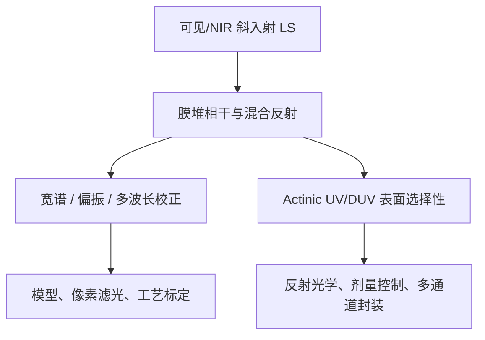

# UVLS 专项：从 process dependence 到表面选择性

## 1. 为什么传统 LS 会被光刻胶和多层膜欺骗

传统斜入射 LS 根据反射光斑/条纹的横向位移推算 Z。若晶圆只有一个不透明表面，这个几何关系直接；但涂胶且已有多层工艺后，接收场是空气/胶表面、胶/底层界面以及更深层界面的复振幅叠加。

薄膜往返相位近似随

$$\phi \propto \frac{4\pi n d\cos\theta_t}{\lambda}$$

变化，其中 $n$、$d$、$\theta_t$、$\lambda$ 分别是膜层折射率、厚度、膜内角度和波长。膜厚或材料略变，就会改变复反射系数的幅度和相位；条纹质心、相位或检测光栅透过强度随之改变，被算法误判为高度。

随附 2021 年论文把它分成两类：

- **ASD — apparent surface depression**：下层反射参与叠加，使测得表面像“下沉”；
- **GPD — gain process dependency**：同样的真实高度变化在不同膜堆上产生不同信号斜率/增益。

宽谱 600–1000 nm 可降低长相干干涉的周期性，但不能保证下层反射消失；多波长加权和偏振差分也依赖模型、标定 wafer 和工艺可观测性。

## 2. UV/DUV 为什么可能改善

如果光刻胶在某短波段有较大的消光系数 $k$，强度穿透深度约随

$$\delta \approx \frac{\lambda}{4\pi k}$$

减小。于是胶表面的反射权重上升，胶/底层及更深界面的贡献被吸收衰减。大入射角还会增加胶内等效传播路径，两者共同让信号更接近“光刻胶最上表面”。

[US8842293B2](https://patents.google.com/patent/US8842293B2/en) 的权利要求正是围绕这一物理选择性：用 photosensitive layer 敏感的 actinic radiation 测其表面；依赖项限定小于 400 nm、剂量预算、离轴反射和光源/探测器匹配。它主要解决 ASD，而 GPD、光斑形状变化和残余多界面相位仍需标定/算法处理。

## 3. 技术链和核心 families

| 角色 | Family | 贡献 | 当前风险含义 |
|---|---|---|---|
| 基础问题/校正 | [US7265364B2](https://patents.google.com/patent/US7265364B2/en) | 不同波长/偏振属性测量之差识别 process dependency | US 已届满快照，属 prior art；其具体后续改进仍可能有效 |
| UVLS 核心 | [US8842293B2](https://patents.google.com/patent/US8842293B2/en) | 光刻胶敏感 actinic 波段直接测表面，小于 400 nm 和剂量控制为依赖项 | 直接采用 resist-sensitive UV/DUV 的总体架构需优先做逐国 claim chart |
| 宽谱/短波光机使能 | [US7646471B2](https://patents.google.com/patent/US7646471B2/en) | 反射件、涂层、偏振和光束路径 | 老 family 是背景；新封装未必自由实施 |
| 无检测光栅阵列 | [WO2016102127A1](https://patents.google.com/patent/WO2016102127A1/en) | 阵列直接采样周期图形，降低检测件对准负担 | 与波段无关，但可成为 UVLS 的探测架构壁垒 |
| 单体/多通道 | [WO2019197111A1](https://patents.google.com/patent/WO2019197111A1/en) | 检测光栅与下游元件一体化 | UVLS 小型化的潜在组合风险 |
| 远置探测/大视场 | [WO2026046750A1](https://patents.google.com/patent/WO2026046750A1/en)、[WO2026052495A1](https://patents.google.com/patent/WO2026052495A1/en)、[WO2026068338A1](https://patents.google.com/patent/WO2026068338A1/en) | 光纤芯相位采样、子视场拼接、双反射中继 | 是 2024 优先权的新 PCT 信号；不应自动等同“UV 专利” |

## 4. 短波带来的新难题

1. **剂量与潜像：** 测量光处在胶敏感波段，LS 本身可能产生预曝光。需要快门/脉冲、低剂量、扫描占空比和曝光剂量 offset；不同胶的敏感度不同。
2. **光子预算：** 短波光源功率、传输效率和 detector QE 往往低于可见/NIR；为维持 throughput，必须在光斑尺寸、带宽、积分时间和通道数之间权衡。
3. **材料与镀膜：** 普通玻璃、胶合剂、偏振器和宽带增透膜在 UV/DUV 下吸收或老化；这推动反射式中继、低胶合/单体件和专用探测器。
4. **散射与污染：** 更短波长对粗糙度和颗粒更敏感，杂散光、表面污染与光学件污染会更突出。
5. **光谱权重：** “短波”不是单一答案。光源谱、胶吸收谱、膜堆反射谱和 detector 响应共同决定有效测量深度；跨工艺仍需 recipe 和标定。
6. **系统空间：** 高入射角、大视场、多通道和物镜/浸没模块争夺空间；反射光学能减色差，却增加遮挡、装调和场拼接难度。

## 5. 谁最早形成重要布局

本轮能够由独立权利要求直接确认的关键分水岭是 ASML 2009-03-13 优先权的 US8842293 family。更早的 ASML、Nikon、Canon families 已经系统处理宽谱、偏振和多波长，但不应在没有 claim 证据时称为“UVLS 核心专利”。随附 2021 年论文模拟短至 200–400 nm 的 ASD 改善，并提出反射式 Offner 光路，这是技术论证，不等同于比 2009 family 更早的有效专利布局。

## 6. 最近 5–10 年是否仍在发展

结论必须分层：

- **充分证据：** ASML 2014–2024 的 families 持续改进可承载短波/宽谱 LS 的 detector-array、动态量程、单体光学、光纤远置探测和反射式大视场架构；其新 PCT 仍引用 2009 UVLS seed。
- **初步信号：** 2021–2024 的多光管均匀照明、field splitting 和双反射中继与 UVLS 的材料/色差/空间需求高度一致，说明“UVLS 的工程化平台”仍在演进。
- **尚未证实：** 本轮没有发现数量相当的新独立权利要求再次把“photosensitive-layer-sensitive wavelength”作为核心新颖点。因此不能仅凭引用和反射结构断言“短波波段本身仍是最新专利竞争焦点”；更可能的重心已经转向多通道、FOV、校准和数据融合。

## 7. 设计启示

自主 UVLS 不能只选一个短波 LED/激光器。应先获得目标胶和膜堆的 $n,k,d$ 数据，联合优化波段、偏振、入射角、NA、光斑、剂量和 detector 响应；同时预留可见/NIR 通道用于高反射率、低剂量或校准场景。专利布局可围绕“工艺自适应光谱选择 + 低剂量估计 + 多 footprint 融合 + 可替换反射模块 + 在线 spectral calibration”的组合，但必须避开现有 actinic measurement、像素滤光、动态量程和多通道一体化的有效 claim。
