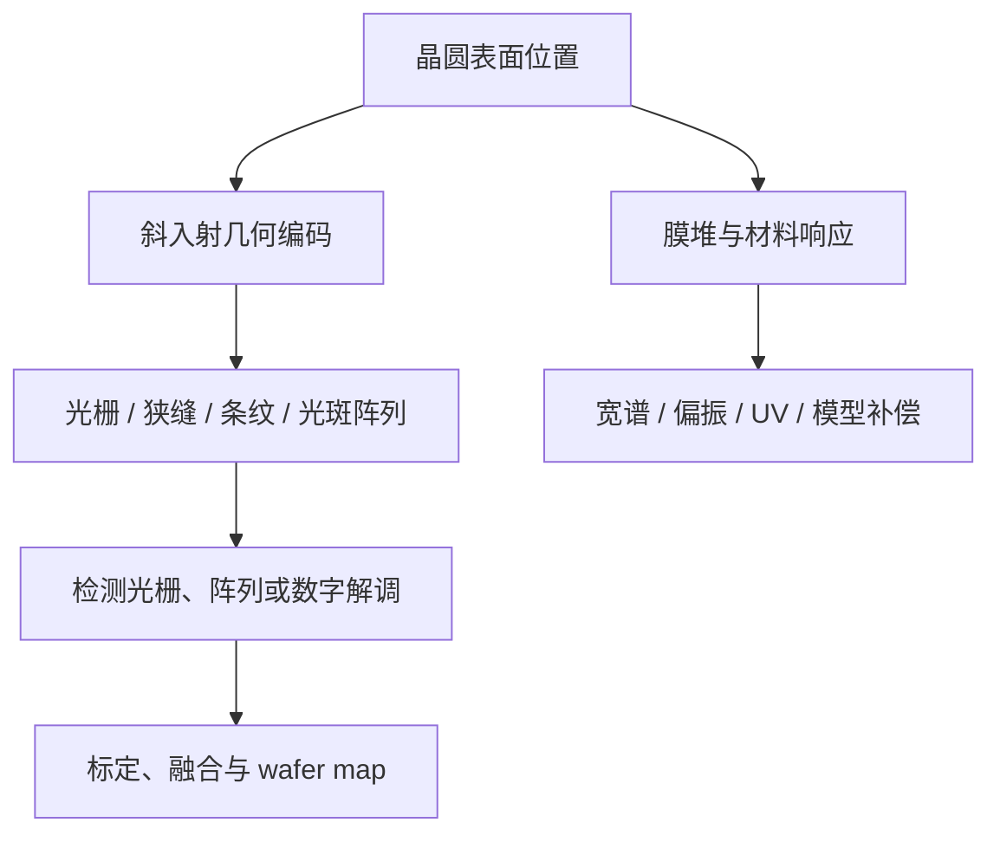

# 光刻机 Level Sensor 全球专利与技术发展调研报告

**版本：v0.1 核心证据集**  
**状态日：2026-09-09**  
**研究边界：2006 年至今为重点，向前追溯基础 families；WO/EP/US/JP/CN/KR；以 Patent Family 和 earliest priority 为主时间轴。**

## 执行摘要

Level Sensor（LS）的演进并非单纯从“低精度”到“高精度”，而是沿四个矛盾展开：

1. 斜入射三角测量需要高灵敏度，但光刻胶/多层膜把反射信号变成多个界面的复振幅叠加；
2. 小光斑提高空间分辨率，却减少光子、加剧图形/粗糙度敏感性并拖慢 wafer map；
3. 高光栅灵敏度缩小 capture range，无法稳定覆盖翘曲、wafer edge 和大台阶；
4. 多点、多色、多偏振提高可观测性，却把通道一致性、热漂移、临界体积和标定推到系统瓶颈。

由此形成三种不同但逐渐汇合的路线：

- **ASML**：从宽谱光栅和偏振/波长差分，转向用光刻胶敏感的 actinic UV/DUV 增强表面选择性；随后重点转为可变 footprint/量程、阵列直采、单体多通道、异构传感融合及 300 mm 大视场反射中继。
- **Nikon**：保留多波长条纹投影，用偏振、光谱和 Goos–Hänchen/薄膜相位模型估计真实 Z；再把滤光集成到 detector pixels，并通过光栅周期/入射条件和共光路降低空气温漂。
- **Canon**：早期采用多波长、多点和扫描式表面位置检测；现代公开重点转为 measurement/exposure 双工位基准传递，以及不同量程和既有曝光区域信息驱动的表面拟合控制。

中国研发并非空白。SMEE 从 2005 年起形成可变 aperture、反射式宽谱、粗精通道、非对称共轭 process rejection、信号归一化、扫描镜监测、空间偏振差分和错位子检测光栅的连续布局；中科院光电所和微电子所分别发展空间差分莫尔与数字光栅/合成莫尔。

本版数据库收录 **38 个核心 family/continuation 分支**，并对 **23 个高相关权利要求分支**建立风险矩阵。它是证据收敛后的核心集，不是以数量为目标的全集。

## 1. 全球研发格局

### 长期持续研发者

| 主体 | 可确认连续期 | 证据强度 | 判断 |
|---|---:|---|---|
| ASML / Philips 历史链 | 1980s–2024 priority | family、引用、架构和部分发明人连续 | 全球最连续、且最新公开仍活跃；覆盖光学头到 wafer-map 系统 |
| Nikon | 至少 1990s 基础至 2012 priority 密集群 | continuation、共同发明人、相互引用 | 条纹投影和光谱/偏振误差工程最系统；2015 后连续性待补检 |
| Canon | 1990s 基础至 2021 priority | 历史多点/多波长 + 现代设备控制 claims | 从传感头转向双工位和数据使用逻辑的连续路线 |
| SMEE | 2005–2018 priority | 多件 CN 授权、引用和模块互补 | 中国最清晰的产业化 LS 专利链 |
| 中科院光电所/微电子所 | 2015、2021 priority 等 | 授权 claims 与实验/论文线索 | 在差分莫尔、数字解调和反射式光学上形成独立分支 |

不能以 family 数量直接推断产品性能或市场领先。ASML 的重要性来自跨 20 年的架构继承和仍在扩展的 claims；Nikon 的价值来自对薄膜相位、偏振和环境误差的系统拆解；Canon 的价值在设备级 reference/data loop；SMEE 的密集 CN claims 则对中国自主开发尤其重要。

## 2. LS 技术分类

核心类别：

- **几何与编码：** 斜入射三角测量，狭缝/光栅/条纹或结构光投影；
- **并行测量：** 多点、多束、线扫、TDI、full-width field split；
- **探测解调：** 对应检测光栅、互补差分、CCD/CMOS 阵列、像素滤光、数字莫尔；
- **工艺适应：** 宽谱、多色/多偏振、UV/DUV 表面选择性、非对称共轭、recipe correction；
- **稳定性：** reference branch、共光路、单体光学、扫描镜监控、主动零位；
- **系统数据：** coarse/fine、不同 footprint、跨工位 reference、wafer-map reconstruction 和曝光控制。

## 3. 三大厂商路线

### ASML

关键转折由 [US7265364B2](https://patents.google.com/patent/US7265364B2/en) 的波长/偏振差分，到 [US8842293B2](https://patents.google.com/patent/US8842293B2/en) 的 actinic UVLS，再到 [WO2016102127A1](https://patents.google.com/patent/WO2016102127A1/en)、[WO2018082892A1](https://patents.google.com/patent/WO2018082892A1/en)、[WO2019197111A1](https://patents.google.com/patent/WO2019197111A1/en) 的阵列直采、动态量程和单体多通道。最新 [WO2026046750A1](https://patents.google.com/patent/WO2026046750A1/en)、[WO2026052495A1](https://patents.google.com/patent/WO2026052495A1/en)、[WO2026068338A1](https://patents.google.com/patent/WO2026068338A1/en) 把 fiber-core detection、field splitting 和 dual reflective relay 写入核心 claims。

其技术逻辑是：先降低“测错表面”，再扩大可用量程/footprint，最后把多通道做得足够紧凑、稳定和宽视场以满足双工位 throughput。

### Nikon

[US9069261B2](https://patents.google.com/patent/US9069261B2/en) continuation 群提供稳定的斜入射/棱镜光学骨架；[US7982884B2](https://patents.google.com/patent/US7982884B2/en) 用局部反射率补偿 slit signal；[US20110071784A1](https://patents.google.com/patent/US20110071784A1/en) 的后续授权把多波长×多偏振用于 GH error correction；[US20130208104A1](https://patents.google.com/patent/US20130208104A1/en) 将颜色/偏振滤光集成到像素；[US9243901B2](https://patents.google.com/patent/US9243901B2/en) 让不同波长对应不同 grating pitch/AOI，从设计层面抑制空气 OPD。

其技术逻辑是：不强求完全隔绝下层反射，而是增加光谱/偏振观测维度，使真实 Z、反射率和薄膜相位可分离，再压缩这些通道之间的环境差分误差。

### Canon

[US6081614A](https://patents.google.com/patent/US6081614A/en) 等历史 families 体现多点预扫描和扫描曝光配合；[US20150042969A1](https://patents.google.com/patent/US20150042969A1/en) 处理测量站到曝光站的 reference transfer；[US20240061350A1](https://patents.google.com/patent/US20240061350A1/en) 以不同量程数据、近似面和阈值控制解决大形变与精细区域兼顾。

其技术逻辑是：让 LS 成为曝光设备 metrology/control chain 的一部分，重点消除“地图是对的，但搬到曝光站后坐标/基准错了”和“同一量程无法兼顾鲁棒性与精度”。

详见 [company_routes.md](../03_analysis/company_routes.md)。

## 4. UVLS 专项结论

传统 LS 的测得值不是纯几何高度，而是膜堆反射复振幅经过光学 pupil、条纹/光斑和 detector 解调后的估计量。宽谱可洗掉部分相干条纹，但无法让底层反射消失；多波长/偏振可估计偏差，但增加模型和标定负担。

UVLS 利用光刻胶在 actinic 短波段的吸收，使胶内穿透深度下降、底层反射权重减小，因此核心价值是降低 ASD、提高对最上表面的选择性。[US8842293B2](https://patents.google.com/patent/US8842293B2/en) 是本轮最早由独立权利要求直接确认的关键布局。

短波同时带来预曝光剂量、光源/探测器效率、材料透过率与老化、散射/污染、光谱匹配和空间集成问题。这解释了后续专利为什么更多落在反射光学、阵列检测、单体件、远置 detector 和大视场，而不是重复声称“使用 UV”。

最近 5–10 年仍有架构性发展证据，但“UV 波段本身仍是最新 claim 竞争中心”尚未被本轮充分证明。详见 [uvls_deep_dive.md](../03_analysis/uvls_deep_dive.md)。

## 5. 从专利反推的真正难点

最高优先级不是抽象的“精度和稳定性”，而是：

1. **哪个界面被测到：** resist top、resist/bottom interface 或更深 pattern 的混合；
2. **height gain 是否随工艺变化：** 同样 Z 在不同 stack 上是否给出相同信号斜率；
3. **有限光子下的 footprint：** edge/局部异常需要小 footprint，全局地图需要高 SNR 和高速；
4. **灵敏度与捕获：** 高斜率 detection grating 常牺牲量程；
5. **多通道是否可长期一致：** 光谱、偏振、fiber、pixel、relay 的 gain/phase/drift 都需标定；
6. **stage 动态是否进入测量：** 扫描镜、晶圆台振动、时间戳和 filter latency 会变成空间形貌；
7. **地图如何被曝光使用：** 跨工位 reference、插值/重建、边缘 partial spot 和不确定度决定最终 focus，而非单点 repeatability。

难点—family—优缺点—成熟度矩阵见 [challenges_and_trends.md](../03_analysis/challenges_and_trends.md)。

## 6. 技术趋势

### 过去约 20 年

演进主线是“模拟强度差分的光学头”→“光谱/偏振/UV 处理 process stack”→“阵列、数字解调和动态量程”→“多传感器、双工位、大视场的 wafer-map 系统”。

### 最近 10 年

充分证据支持：检测光栅向阵列/单体/数字化演进；多通道同时承担光谱、偏振、量程和 footprint；校准从零位扩展到 scan mirror、通道和 station reference；throughput 成为 claim 的直接对象。

### 最近 5 年

充分证据支持：Canon 的多量程/区域控制、中科院微电子所的数字光栅、ASML 的均匀照明与 2024 priority 大视场/光纤检测。初步信号是全反射大视场平台兼容更宽/更短波段。推测是下一阶段会出现 recipe-driven spectral selection、物理模型加受约束数据补偿、在线不确定度和自适应稀疏扫描。

## 7. Preliminary Patent Risk / FTO

### 最高优先级 families

| 风险区域 | 需优先核验的 families |
|---|---|
| resist-sensitive UV/DUV | ASML-2009-UVLS / US8842293 family |
| 周期图形阵列直采 | ASML-2014-DIRECTARRAY / WO2016102127 family |
| 动态量程/多 footprint | ASML-2016-RANGE; ASML-2019-FUSION; CANON-2021-MULTIRANGE |
| 紧凑多通道 | ASML-2018-MONOLITHIC; ASML-2024-FIBERDETECT |
| 光谱/偏振薄膜补偿 | NIKON-2009-GH; NIKON-2011-PIXELFILTER; NIKON-2012-AIRTEMP |
| 双工位 reference | CANON-2013-TWINSTATION |
| 中国市场差分/校准 | CN104880913B; CN106997152B; CN108106561B; CN110095944B; CN115185161B |
| 未来大视场 | WO2026052495A1; WO2026068338A1（PCT 在审信号） |

详细 element summary、design-around 与核验动作见 [claim_risk_matrix.csv](../04_claims/claim_risk_matrix.csv) 和 [preliminary_fto.md](../04_claims/preliminary_fto.md)。没有具体自主设计时，任何 HIGH 只能理解为“先查”，不能理解为“已侵权”。

## 8. 对自主 LS 研发的建议

### 技术架构

- 在光学定型前建立 resist/stack 的 $n,k,d$ 数据库和表面高度真值平台；ASD、GPD 和随机噪声必须分开验证。
- 不把“宽谱”“大角度”或“UV”当成单一答案；联合优化波段、偏振、AOI、NA、剂量、footprint 和 detector QE。
- 设计至少两个可观测层级：高鲁棒性 coarse/global map 与高分辨率 local map，但数据关系应在专利评审后选择。
- 从第一版样机就引入 reference drift、通道 gain/phase、stage timestamp、wafer edge partial spot 和长期污染监控。
- wafer map 输出应带不确定度和 quality flag，避免把 process-dependent outlier 强行拟合进曝光面。

### 专利布局

- 优先围绕“工艺自适应光谱/偏振/角度策略 + 低剂量约束 + 在线标定 + uncertainty-aware reconstruction”的组合申请，而不是重复基础三角测量。
- 把光机、探测 ASIC/CMOS、标定 artifact、信号模型和 stage control 拆成可组合但独立保护的 claim 层级。
- 对中国市场尤其警惕 SMEE 的有效 CN claims；对全球市场优先监控 ASML/Nikon/Canon 的 continuation 与最新 PCT national phase。
- 在产品需求阶段就维护 claim chart，设计变更必须记录对应 family 和理由，不能等样机冻结后再做 FTO。

## 9. 十二个问题的直接答案

1. **谁长期持续研发？** ASML/Philips、Nikon、Canon 是全球长期主体；SMEE 在中国形成至少 2005–2018 的连续产业链；中科院光电所/微电子所是重要科研力量。ASML 的最新公开连续性最强。
2. **三家路线分别是什么？** ASML：UV 表面选择性 + 多通道/大视场；Nikon：多波长×偏振 GH/环境补偿；Canon：多点扫描 + 双工位 reference/量程控制。
3. **共性和差异？** 共性是斜入射、图形投影、多点和 wafer map；差异是 ASML 改变测量波段/光机平台，Nikon 增加光谱偏振可观测性，Canon强化设备级数据闭环。
4. **20 年最重要演进？** 从单光学头的强度测量转为 process-aware、多通道、可校准的系统级 topography metrology。
5. **UVLS 为什么出现、价值是什么？** 因传统波段穿透光刻胶并混入下层反射；UV/DUV 利用胶吸收增强最上表面选择性，主要降低 ASD。
6. **UVLS 核心 families？** 直接核心是 ASML-2009-UVLS；前驱为 ASML-2004-DIFFPROP，工程化相关为 ASML-2014-DIRECTARRAY、2018-MONOLITHIC 及 2024 的 fiber/FOV relays，但后者不能都称为 UV-specific claims。
7. **当前最重要难点？** process stack 的界面混合和 gain、footprint/SNR、灵敏度/量程、多通道漂移、stage dynamic、wafer edge 和地图到曝光的 reference transfer。
8. **最近 5 年方向？** 数字解调、多量程控制、均匀照明、fiber remote detection、field splitting 和双反射大视场 relay。
9. **下一阶段可能如何演进？** recipe-driven multispectral sensing、物理+数据残差模型、异构融合、在线自校准和自适应全宽采样；这些是推测，不是已确认事实。
10. **最值得警惕哪些 families？** US8842293、WO2016102127、WO2018082892、WO2019197111、US11662669、Nikon GH/pixel-filter/air-temperature families、Canon twin-station/multi-range families，以及中国五组有效 claims 和 ASML 2024 priority PCT。
11. **哪些区域壁垒密集？** 投影/检测光栅、多波长/偏振 process correction、actinic UV、detector-array 解调、动态量程/footprint、同时空间差分、跨工位 reference 和 compact wide-field relays。
12. **哪里仍有空间？** 工艺自适应光谱与剂量闭环、非既有光栅组合的编码、edge partial-spot 物理模型、可追溯在线 reference、uncertainty-aware wafer-map 与 stage-aware compressed sampling。

## 10. 数据与证据限制

- 专利公开存在约 18 个月窗口，2025–2026 的未公开申请不可见；
- Google Patents 状态不是法律意见，且 family/assignee 可能不完整；
- 部分 Canon 历史 seed 和 Nikon 后续支线仍需回到官方全文补齐；
- WO 公布的 claim 可能在 national phase 大幅修改；
- 本版不把标题/摘要相关性当作 FTO，风险矩阵仅纳入已读独立 claim 或明确标注“待读”的分支。

## 11. 主要证据入口

- 核心数据：[patent_families.csv](../02_data/patent_families.csv)
- 方法与证据等级：[research_methodology.md](../00_methodology/research_methodology.md)
- 检索复现：[search_strategy.md](../01_search/search_strategy.md) 与 [search_log.csv](../01_search/search_log.csv)
- 两份随附资料：《纳米光刻中调焦调平测量系统的研究》（中国科学院大学，2016）；《反射式光学调焦调平测量系统技术研究》（中国科学院大学，2021）。论文只作为 E3 线索，关键结论已尽量回到上述专利全文。

---

**免责声明：** 本报告是技术情报和 preliminary patent-risk screening，不构成正式法律意见。正式 FTO 必须基于具体产品、目标地域、有效权利要求、审查历史和法律专业判断。
